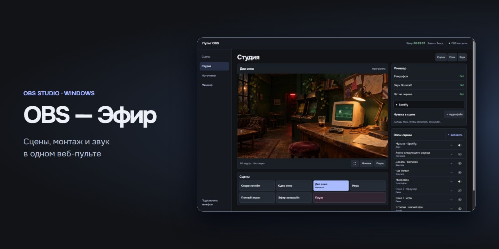
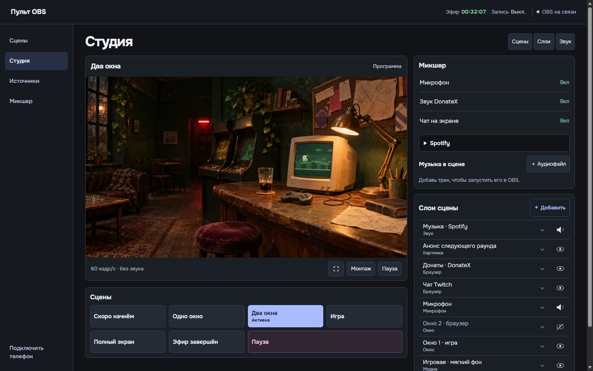
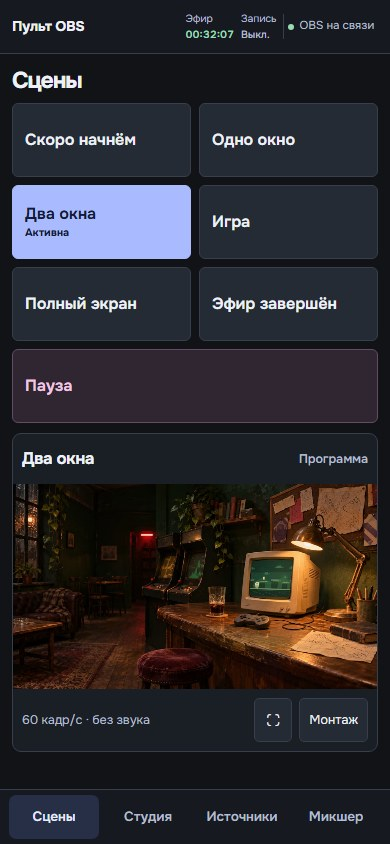

# OBS Remote

**Универсальный веб-пульт для OBS Studio.** Подключи его к своему OBS и управляй сценами, источниками и звуком с компьютера или телефона.

OBS Studio web remote with live preview, mobile scene deck, source editor, audio controls, and an optional Linux HTTPS gateway.

[Установка](./docs/INSTALLATION.md) · [Настройка сцен](./docs/setup-scenes.md) · [Облачный доступ](./docs/CLOUD.md) · [Обновление](./docs/UPGRADING.md) · [Диагностика](./docs/TROUBLESHOOTING.md) · [English](./docs/README.en.md)



| Студия на компьютере | Сцены на телефоне |
| --- | --- |
|  |  |

## Возможности

| Раздел | Что можно делать |
| --- | --- |
| **Сцены** | Список сцен автоматически загружается из OBS. Переключение сразу синхронизируется с программой. |
| **Студия** | Видеть программный кадр, сцены, слои и микшер в одной рабочей области. |
| **Монтаж** | Добавлять изображения, текст, окна и видео. Перемещать, масштабировать, поворачивать и скрывать слои. Новый текст и изображения появляются за кадром, откуда их можно перетащить в эфир. |
| **Заготовки** | Сохранять источник на полку и вставлять в разные сцены с отдельным положением и размером. |
| **Звук** | Включать и выключать звук поддерживаемых источников текущей сцены OBS, включая микрофоны, браузерные виджеты и музыку. |
| **Предпросмотр** | Смотреть видео OBS по сети. Проверенный режим — 960×540 при 60 FPS, без звука. |

## Установка

### Windows и OBS Studio

Склонируй основной репозиторий и запусти установщик:

```powershell
git clone https://github.com/evi1argument/obs-efir.git
cd obs-efir
powershell -ExecutionPolicy Bypass -File .\install.ps1
```

Выбери установку зависимостей, затем запуск. В OBS включи **Инструменты → Настройки сервера WebSocket**, аутентификацию и задай пароль. Открой `http://127.0.0.1:8787/pair` на компьютере с OBS и подключи телефон к той же Wi-Fi сети.

### Linux VPS

На VPS с DNS-записью домена выполни:

```bash
git clone https://github.com/evi1argument/obs-efir.git
cd obs-efir
sudo bash install.sh cloud
```

Установщик настроит Docker Compose, HTTPS через Caddy и параметры обратного SSH-туннеля. Полный порядок действий описан в [инструкции по установке](./docs/INSTALLATION.md) и [схеме облачного доступа](./docs/CLOUD.md).

### Локальный Linux

```bash
git clone https://github.com/evi1argument/obs-efir.git
cd obs-efir
sudo bash install.sh local
```

Пульт не требует конкретных названий сцен, источников, донат-сервиса или музыкального сервиса. Настройка сцен, звука, донатов и музыки описана в [отдельной инструкции](./docs/setup-scenes.md).

## В репозитории

- [Исходники веб-пульта](./Пульт%20OBS/).
- [Конфигурация Linux-шлюза](./deploy/).
- [Политика безопасности](./SECURITY.md).

Профиль OBS, коллекция сцен, пользовательские загрузки и токены остаются на компьютере пользователя.
