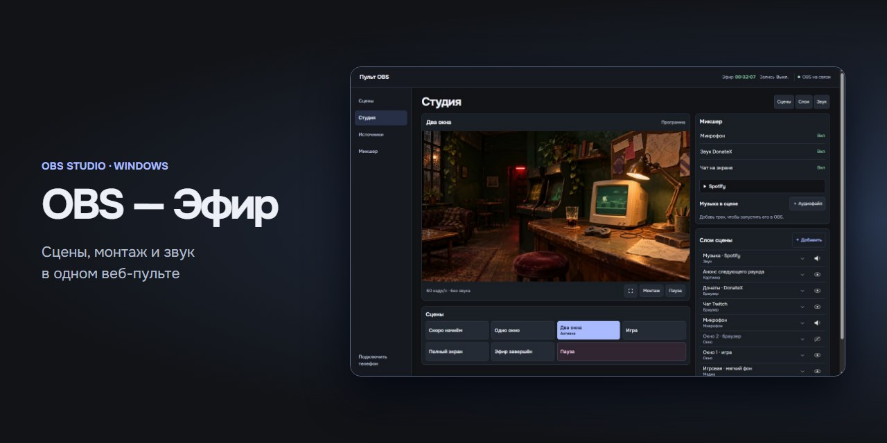
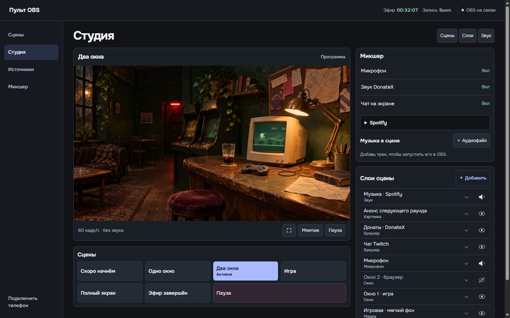
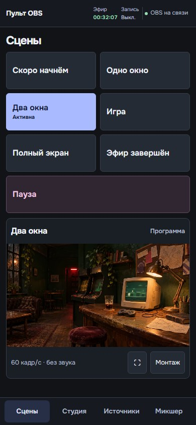

# OBS Remote

**A web remote for OBS Studio.** Connect it to your OBS and control scenes, sources, and audio from your computer or phone.

[Installation](./INSTALLATION.en.md) · [Scene setup](./setup-scenes.en.md) · [Cloud access](./CLOUD.en.md) · [Upgrade](./UPGRADING.en.md) · [Troubleshooting](./TROUBLESHOOTING.en.md) · [Русский](../README.md)



| Desktop studio | Scenes on a phone |
| --- | --- |
|  |  |

The remote's interface is currently in Russian. The guides below include its Russian button labels alongside their English descriptions.

## Features

| Section | What you can do |
| --- | --- |
| **Scenes** | Load scenes automatically from OBS and switch between them. Changes are reflected in the remote. |
| **Studio** | See the program output, scenes, layers, and mixer in one workspace. |
| **Editing** | Add images, text, windows, and video; move, resize, rotate, and hide layers. New text and images are placed outside the frame until you move them in. |
| **Shelf** | Save a source and insert it into other scenes with a separate position and size. |
| **Audio** | Mute and unmute supported sources in the current OBS scene, including microphones, browser widgets, and music. |
| **Preview** | Watch the OBS output over the network. The tested mode is 960×540 at 60 FPS without audio. Source snapshots appear outside the canvas. |

## Installation

On Windows, clone the repository and run the installer:

```powershell
git clone https://github.com/evi1argument/obs-efir.git
cd obs-efir
powershell -ExecutionPolicy Bypass -File .\install.ps1
```

The menu installs dependencies and starts the remote. Enable the OBS WebSocket server with authentication before opening `http://127.0.0.1:8787/pair` on the OBS computer.

On a Linux server, clone the repository and run:

```bash
git clone https://github.com/evi1argument/obs-efir.git
cd obs-efir
sudo bash install.sh cloud
```

The installer configures Docker Compose, HTTPS through Caddy, and the reverse SSH tunnel to OBS. See the [installation guide](./INSTALLATION.en.md) and [cloud guide](./CLOUD.en.md).

For a manual start:

You need Windows, **Node.js 24**, and **OBS Studio with WebSocket 5**. The project runs without installing npm packages.

1. In OBS, enable the WebSocket server under **Tools** and enable authentication.
2. Run [start-remote.cmd](../Пульт%20OBS/start-remote.cmd), or run:

   ```powershell
   cd 'Пульт OBS'
   node server.mjs
   ```

3. Open the [pairing page](http://127.0.0.1:8787/pair) on the computer. On a phone connected to the same Wi-Fi network, scan the QR code or enter the address and code shown.

The [scene setup guide](./setup-scenes.en.md) covers scenes, audio, donations, and music, with a suggested layout and an example JSON file.

Video preview requires FFmpeg with DirectShow and libx264. Set `OBS_REMOTE_FFMPEG` or install the Python package `imageio_ffmpeg`. QR generation requires `opencv-python`; manual pairing works without it. Spotify controls use the Spotify desktop app and its Windows media session.

## In this repository

- [Web remote source code](../Пульт%20OBS/).
- [Linux gateway configuration](../deploy/) and [security boundaries](../SECURITY.md).

The OBS profile, scene collection, user uploads, and tokens stay on the user's computer. The remote does not require a particular scene layout, visual theme, or donation service; it synchronizes with the user's OBS setup.
